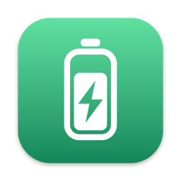
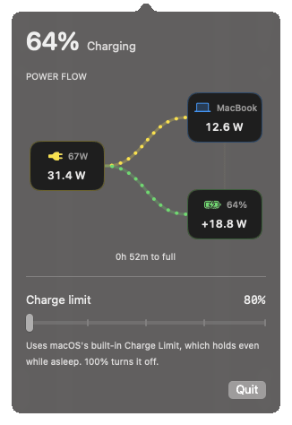

<p align="center">
  
</p>

<h1 align="center">Plateau</h1>

<p align="center">
  A minimal menu bar charge limiter for Apple Silicon MacBooks.
</p>

<p align="center">
  
  
  
  <a href="LICENSE"></a>
</p>

<p align="center">
  
</p>

Keeping a lithium-ion battery at 100% while plugged in all day wears it out faster. Plateau caps the
charge at a level you choose and shows exactly where your power is going, without the clutter of a
full battery utility.

## Features

- **Charge limit:** pick where charging stops. On macOS 27+ this uses macOS's built-in Charge Limit,
  so it holds even while the Mac is asleep or the app is quit.
- **Live power flow:** watts from the adapter, into the Mac and into or out of the battery, updated
  every 2 seconds while the popover is open.
- **Accurate menu bar icon:** the battery fills to your real charge level and shows a bolt when plugged in.

  
- **Light on resources:** about 0% CPU and 12 MB of memory. The power-flow animation runs on Core Animation.
- **Never blocks sleep:** closing the lid or choosing Sleep always works normally.

## Requirements

- A MacBook with Apple Silicon
- macOS 13 or later
- Xcode 15 or the Command Line Tools (Swift 5.9) to build

## Install

Plateau isn't distributed as a signed binary yet. Build it from source:

```sh
git clone https://github.com/basitanwer/plateau.git
cd plateau
./build.sh --install   # builds, copies to /Applications and launches it
```

`./build.sh` on its own builds `build/Plateau.app` without installing it. To start Plateau at login, add it in
**System Settings → General → Login Items**.

## How it works

### macOS 27 and later

Apple gated the SMC charge-control keys (`CHTE` is gone). Plateau instead sets macOS's own Charge Limit
through the private `PowerUISmartChargeClient`, the same interface System Settings uses. Limits are 80–100%
in steps of 5, and the firmware enforces them even while the Mac is asleep. No helper or admin password is needed.
If the older helper is installed, the app offers to remove it.

### macOS 26 and earlier (helper mode)

Click the menu bar item and choose **Install helper** (it asks for your admin password once). Limits from 20–100% are supported.

- `Helper` is a root LaunchDaemon (`com.basitanwer.plateau.helper`) that checks every 5 seconds and
  toggles the SMC `CHTE` key (charge inhibit) to keep the battery at the limit. Charging resumes once the
  battery drops 2% below the limit, or right away when you raise the limit.
- Stopping the daemon leaves the charge state alone, so shutting down doesn't charge to 100%. The uninstall
  script restores normal charging.
- While plugged in and charging toward the limit, the helper prevents *idle* sleep only. If the Mac goes to
  sleep within 5% of the limit, charging is paused first so it can't overshoot. On wake, the limit is re-checked immediately.
- The app writes the limit to `/Library/Application Support/Plateau/limit` (owned by your user, read-only to others),
  so the limit is enforced even when the app isn't running.

Logs are in `/var/log/plateau.log`. To check the helper's status:

```sh
build/Plateau.app/Contents/Resources/plateau-helper status
```

### Power readings

Live values come from the SMC: adapter input (`PDTR`), total system power (`PSTR`) and battery current × voltage
(`B0AC` × `B0AV`). `AppleSmartBattery` telemetry only refreshes about once a minute, so it's used as a fallback.

## Development

```sh
swift build    # debug build
swift test     # charge/sleep policy and hardware read tests
```

The app icon is drawn in code by `Support/make-icon.swift`. `build.sh` re-renders it whenever that file changes.

## Uninstall

```sh
sudo /Applications/Plateau.app/Contents/Resources/uninstall-helper.sh   # only if you installed the helper
rm -rf /Applications/Plateau.app
```

## Disclaimer

Plateau uses private macOS interfaces and SMC keys that Apple doesn't document. They can change with any macOS
update. Use it at your own risk.

## License

[MIT](LICENSE) © 2026 Basit Anwer
